# Kiosk — sell anything on your Flarum forum

 

Sell memberships, premium tags, single discussions, posting passes, bumps and tips — and whatever other extensions make sellable, such as [Atrium](https://ernestdefoe.online) albums, [Social Groups](https://github.com/ernestdefoe/social-groups) and [Syllabus](https://github.com/ernestdefoe/syllabus) courses. Take payment with PayPal, Stripe or crypto. Setup is pasting a key or two: Kiosk creates the plans, prices and webhooks at the provider for you.

Kiosk is free and MIT-licensed. You choose what is for sale; tax is up to you.

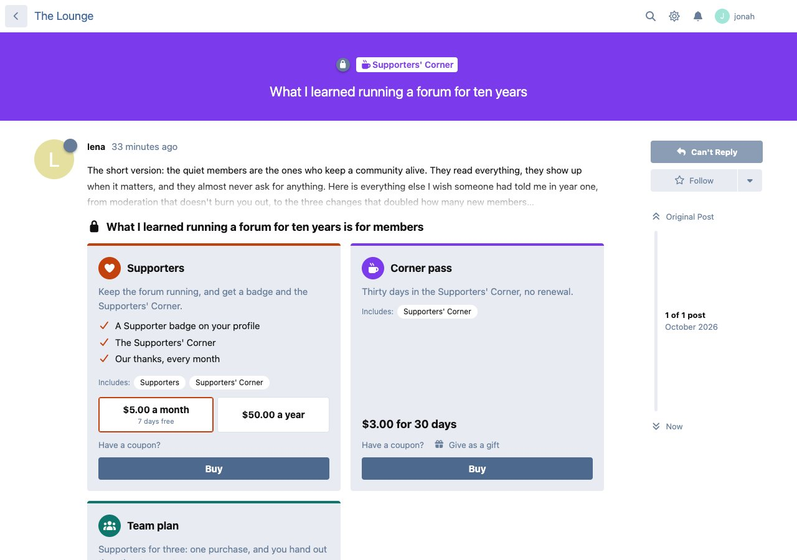

## What you can sell

Every product unlocks one or more things, and has one or more prices.

| Unlock | What the buyer gets |
| --- | --- |
| **Group** | Membership of a group, with its permissions and badge. Use it for memberships and supporter badges. |
| **Tag** | A paid section. Choose per tag: hidden from everyone else, or a **teaser** that shows titles and the opening words of each discussion, faded out, with an offer to buy. |
| **Discussion** | One discussion sold on its own ("pay to view"). The first post's opening words stay visible. |
| **Posting in a tag** | Credits to start discussions in a tag ("pay to post"), for classifieds or job boards. |
| **Bumps** | Credits to bump your own discussion back to the top. |
| **Tips** | Members back a discussion with an amount they choose; the total shows on the discussion ("tips and bounties"). |
| **Remove ads** | No Kiosk ads anywhere on the forum, for as long as the buyer holds it. |
| **Course, album, social group** | With Syllabus, Atrium or Social Groups installed: a course, an album, or a group people pay to join. |

| Price | How it is paid |
| --- | --- |
| **Renews** | Monthly, yearly, or any interval, with an optional free trial. Subscribers can switch plan and stop renewing from **My purchases**. |
| **One-time** | Yours to keep. |
| **Set time** | For a number of days, with no renewal (a 30-day pass). |
| **Pay what you want** | The buyer chooses, at or above your minimum. |

A price can also be a **team plan**: give it more than one seat, and the buyer hands the other seats to members from **My purchases**.

## Features

- **A store page** at `/store`, and **My purchases** at `/store/purchases`, where members see what they have, when it renews or ends, their payments, and manage subscriptions and seats.
- **Buy buttons where they matter.** A locked tag or discussion shows the product that opens it. Other extensions show Kiosk's offer on their own pages.
- **Coupons**: a percent or an amount off, for every product or some, with a use limit and an end date. A one-time purchase can be made free; a subscription can't.
- **Gifts**: buy a one-time or set-time product for another member by username.
- **Plan switching**: Stripe switches at once and settles the difference on the next bill; PayPal asks the buyer to approve, and the next bill is at the new price.
- **An admin page** with a setup checklist, sales numbers, products (drag to order), purchases (grant, cancel, end, refund), coupons, payment providers, a log of every notification the providers sent (with Run again), and settings.
- **Sell this** buttons on the group, tag and other extensions' edit screens.
- **Receipts and reminders** in the bell and by email: purchase complete, a gift, a seat, a renewal coming up, a failed payment, access ended.
- **Grace days**: a renewal that is a day or two late doesn't lock a paying member out.
- **Ads**: your own ads in nine spots, with Remove ads for sale (see below).
- **Moving from floxum/payments**: `php flarum kiosk:import-floxum` (see below).
- Translatable, works in light and dark mode, and adds about 8 KB (gzipped) to the JavaScript every page loads. The store pages load only when opened.

## Screenshots

| The store | A paid section as a teaser |
| --- | --- |
| 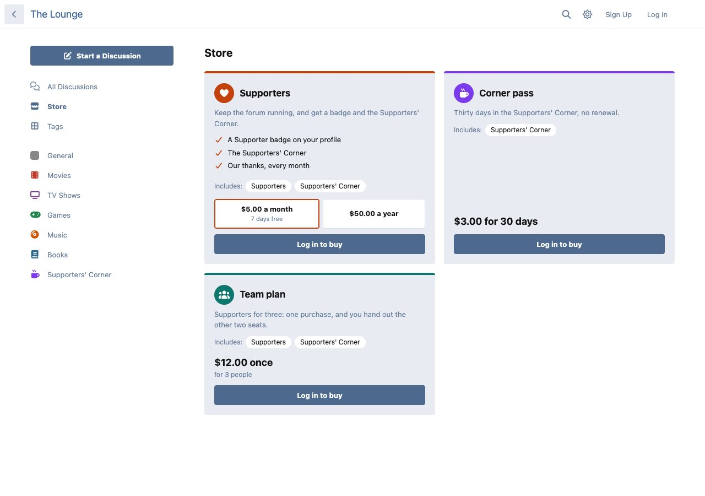 | 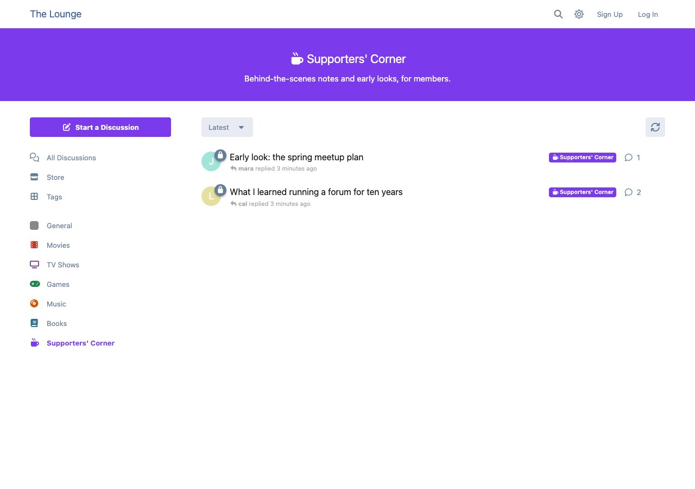 |

| A coupon on a product | My purchases, with a team plan's seats |
| --- | --- |
| 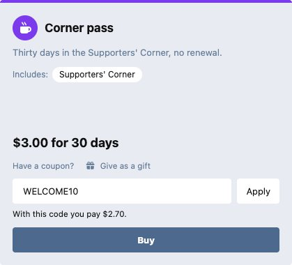 | 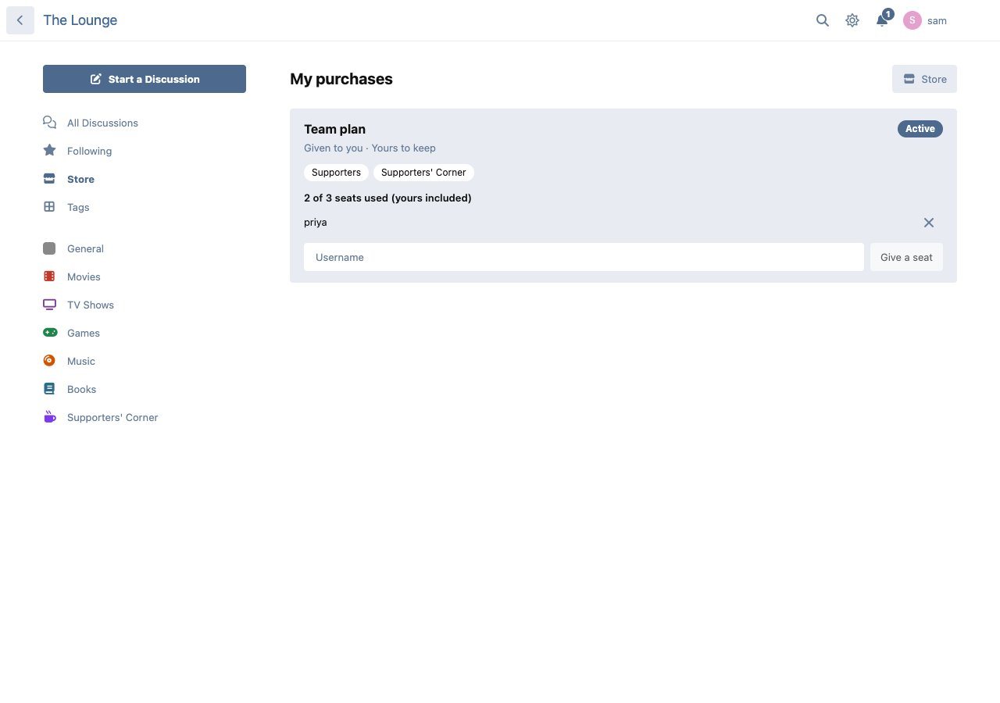 |

| The admin's setup checklist | Coupons |
| --- | --- |
| 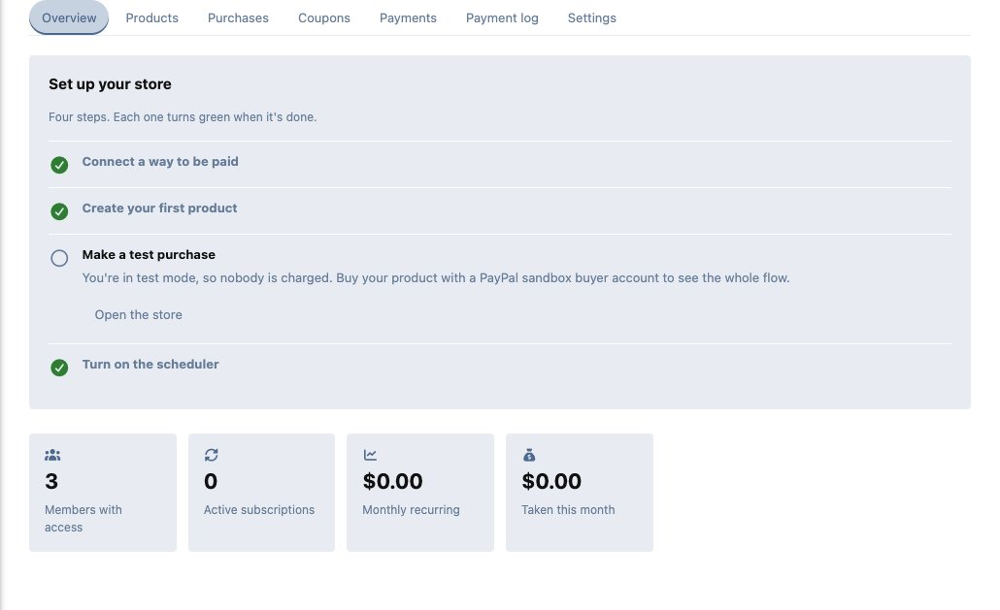 | 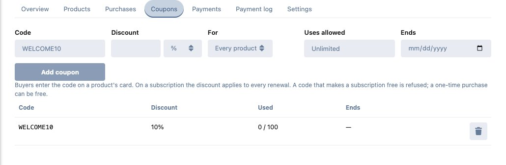 |

| Products | Payment providers |
| --- | --- |
| 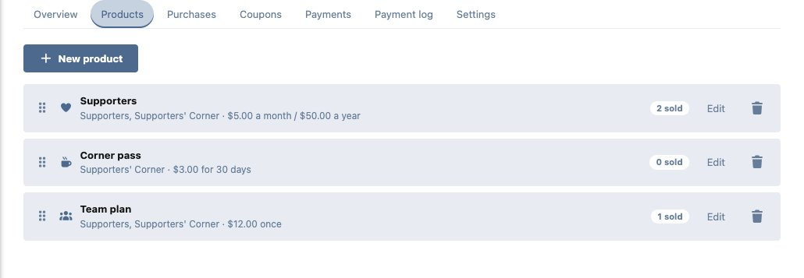 | 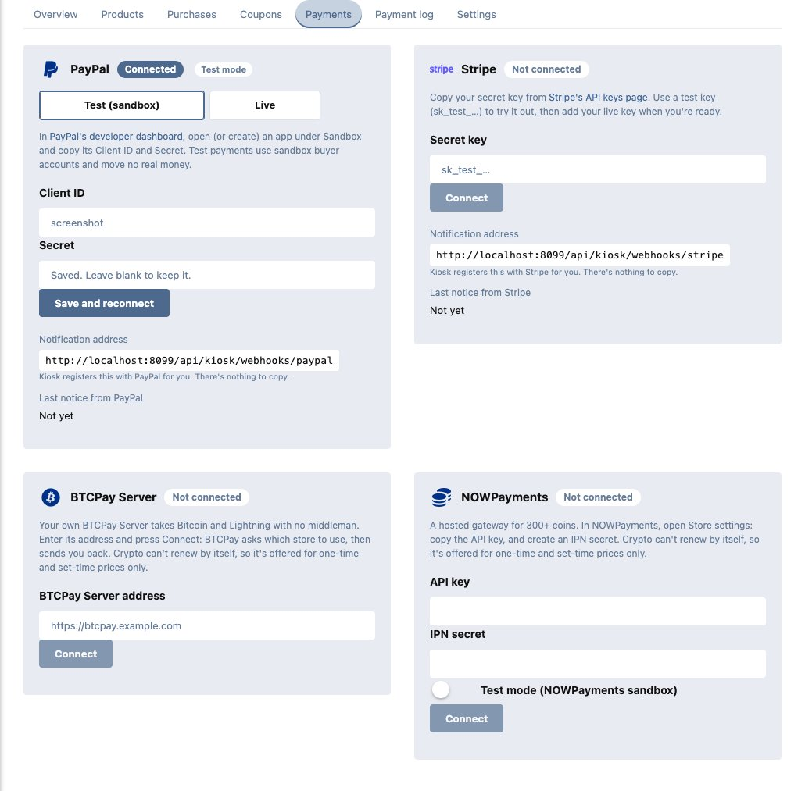 |

| Ads at the top and below the banner | Ads after the first post and in the discussion sidebar |
| --- | --- |
| 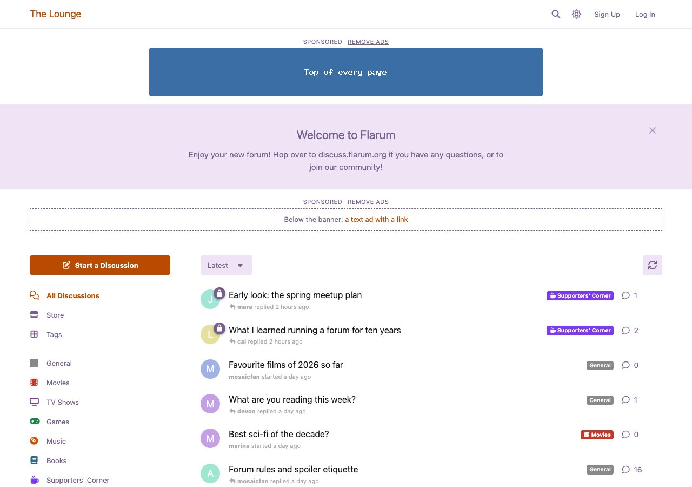 | 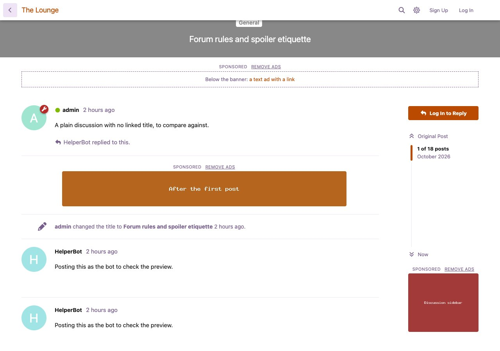 |

| The Ads tab | Making an ad |
| --- | --- |
| 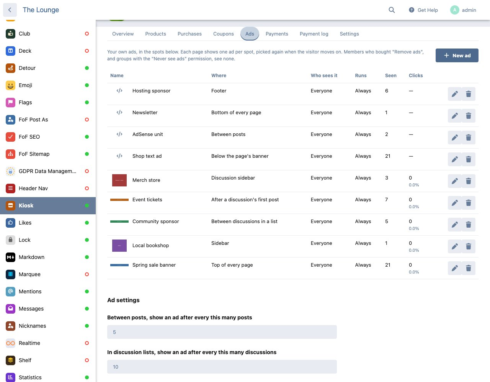 | 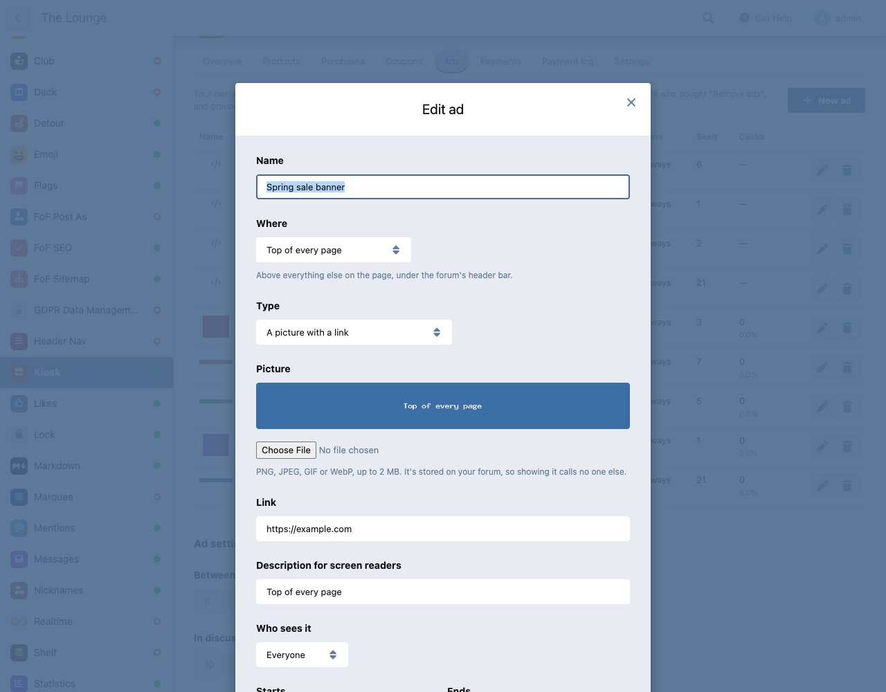 |

## Installation

```sh
composer require ernestdefoe/kiosk
```

Then enable **Kiosk** in the admin panel and follow its checklist: connect a way to be paid, create a product, make a test purchase, and turn on Flarum's scheduler.

Kiosk uses Flarum's scheduler for renewal reminders and tidying up. Access always ends on time without it. Add this line to your server's crontab:

```
* * * * * cd /path/to/flarum && php flarum schedule:run
```

## Updating

```sh
composer update ernestdefoe/kiosk
php flarum migrate
php flarum cache:clear
```

## Payment providers

All of them need your forum on a public `https://` address, so the provider can tell Kiosk about payments.

### PayPal

In [PayPal's developer dashboard](https://developer.paypal.com/dashboard/applications), open (or create) an app and copy its **Client ID** and **Secret** into Kiosk → Payments. Start in Sandbox to test with sandbox buyer accounts, then add your Live keys and switch. Kiosk registers its webhook with PayPal for you.

PayPal takes one-time payments and subscriptions. Buyers can also pay with the crypto in their PayPal wallet, where PayPal offers it.

### Stripe

Copy your **secret key** from [Stripe's API keys page](https://dashboard.stripe.com/apikeys) into Kiosk → Payments: `sk_test_…` to try it, `sk_live_…` when you're ready. Kiosk creates the webhook endpoint and the prices itself. To have Stripe add sales tax, turn on Stripe Tax in your Stripe dashboard, then **Let Stripe add sales tax** in Kiosk's settings.

> **Stripe hasn't been tested with real payments yet.** It is covered by automated tests against Stripe's documented API, but not by a live sandbox run. Please [report anything that goes wrong](https://github.com/ernestdefoe/kiosk/issues).

### Crypto: BTCPay Server and NOWPayments

- **BTCPay Server** (your own, self-hosted: Bitcoin and Lightning, no middleman). Enter its address and press **Connect**: BTCPay asks which store to use and sends you back. Kiosk makes the webhook.
- **NOWPayments** (hosted, 300+ coins). In its Store settings, copy the **API key** and create an **IPN secret**, and paste both.

Crypto can't renew by itself, so it is offered for one-time and set-time prices only (add a 30-day price for crypto payers if you sell subscriptions). Refunds are sent from the gateway's own dashboard; then press **End** on the purchase.

> **Crypto hasn't been tested with real payments yet.** It is covered by automated tests against each gateway's documented API. Please [report anything that goes wrong](https://github.com/ernestdefoe/kiosk/issues).

## Ads

Run your own ads on the forum from the **Ads** tab, and let members pay to remove them.

- **Nine spots**: top of every page, below the page's banner, the sidebar, between discussions in a list, after a discussion's first post, between posts, the discussion sidebar, the bottom of every page, and the footer. The first six match Ad Management's zones.
- **Two kinds**: a picture with a link (uploaded to your forum, so showing it calls no one else), or pasted code for AdSense or another network.
- **Who and when**: everyone, guests only or members only, with optional start and end dates. Each page shows one ad per spot, picked again when the visitor moves on; between posts and discussions, the ads take turns.
- **Remove ads**: add *Remove ads* to any product (an ad-free membership, or on top of a supporter tier). Buyers see no ads while they hold it, and every ad shows a "Remove ads" link to that product.
- **Counts**: how often each ad was seen (at least half on screen) and clicked, per day. No IP addresses or member names are stored.
- **Light**: the ads a visitor may see come with the page, cached, so a page costs no extra query or request. Seen counts are sent in batches.

## Permissions

| Permission | Default | What it allows |
| --- | --- | --- |
| Read paid content without buying | Moderators | Read paid tags and discussions in full, to moderate them. |
| Never see ads | Moderators | No Kiosk ads. Admins always see them, so they can check what members see. |

Buying needs a confirmed email address. Products can be limited to some groups (for example, "verified members only").

## Moving from floxum/payments

1. Install Kiosk and connect **the same Stripe account** in Kiosk → Payments.
2. See what would come across: `php flarum kiosk:import-floxum --dry-run`
3. Import: `php flarum kiosk:import-floxum`
4. Check the new products, then disable floxum/payments and delete its webhook endpoint in Stripe.

The importer makes a product for every paid group and every paid tag feature (view, post, bump, bounty), tied to the same Stripe prices. Live subscriptions become Kiosk purchases that Stripe goes on billing, so nobody pays twice. People who paid to view a discussion keep reading it, and bounties carry over as tips. It is safe to run again.

## For developers

Other extensions can make their things sellable by registering an unlock type, and can show Kiosk's offer on their own pages:

```php
// extend.php
new \Ernestdefoe\Kiosk\Extend\UnlockType('my-thing', MyThingUnlock::class),
```

```js
const LockedNotice = flarum.reg.get('ernestdefoe-kiosk', 'forum/components/LockedNotice');
```

See `src/Unlock/UnlockType.php` for the interface, and Syllabus, Atrium or Social Groups for working examples.

## Troubleshooting

- **The checklist says the scheduler isn't running.** Add the crontab line above. Without it, renewal reminders aren't sent, and abandoned checkouts and missed notifications are tidied up only when someone visits.
- **A payment went through but nothing opened.** Look at Kiosk → Payment log: a failed notification shows its error and a **Run again** button. Most often the forum wasn't reachable on `https://` when the provider called.
- **Connecting PayPal says it won't send notifications.** PayPal needs a public `https://` address; a local or `http://` forum can't receive them.

## Links

- [Source code](https://github.com/ernestdefoe/kiosk)
- [Report a problem](https://github.com/ernestdefoe/kiosk/issues)
- [Buy me a coffee](https://buymeacoffee.com/ernestdefoe)
